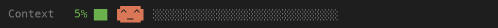
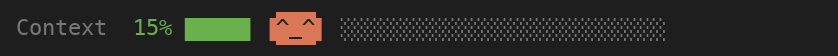
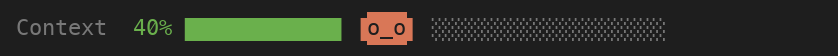
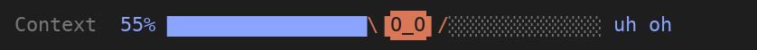
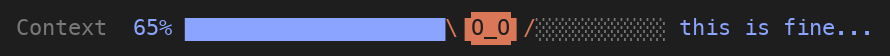
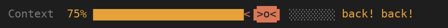
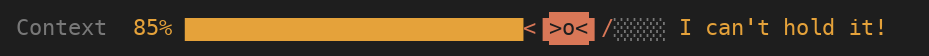
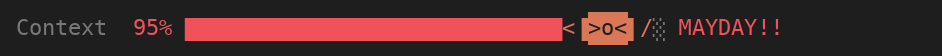
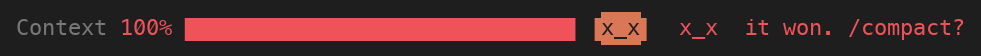

# context-meter

A mod for Claude Code that shows how full the context window is, and gives you
escalating warnings as it fills. A small orange Claude mascot lives on the bar:
it strolls around while there is plenty of room, panics more and more as usage
climbs, and from 70% tries (and fails) to push the bar back.

## Preview

The whole climb, from an empty window to a full one:



### The moods

| | |
|---|---|
| **Calm** (under 30%): strolls the empty track<br> | **Wary** (30-49%): walks more carefully<br> |
| **Worried** (50-59%): flailing and running<br> | **Panicking** (60-69%): eyes spinning, "this is fine..."<br> |
| **Pushing** (70-79%): shoving the bar back, and losing<br> | **Struggling** (80-89%): "I can't hold it!"<br> |
| **Mayday** (90-99%): shoving with everything it has<br> | **Defeated** (100%): the bar wins<br> |

These animations are rendered from the mod's own layout code, drawn in a
terminal-style font, so the real band looks the same apart from your terminal's
font and theme colors.

## What you get

- **Status line and band** above the prompt with a progress bar and percentage,
  colored green, then blue (50%), orange (70%) and red (90%), following your
  theme's colors.
- **A toast at every additional 10%** with its own message, the token count, and
  longer display time as it gets more serious. At 80% and above you also get a
  native notification.
- **Smart re-arming:** if you `/compact` or `/clear`, the alerts reset for the
  climb back up. A jump over several steps announces only the highest one.
- **The mascot:** calm under 30%, wary to 50%, flailing to 70%, then shoving the
  bar back (and losing) at 70%, 80% and 90%, and `x_x` at 100%.
- `/context-meter` hides or shows the band.

## Install

At the prompt of a terminal Claude Code session:

```
/plugin install context-meter --marketplace Yuds16/context-meter
```

Answer `y` to add the marketplace, then pick a scope.

From a shell:

```
claude plugin install context-meter --marketplace Yuds16/context-meter
```

In the desktop app, where `/plugin` does not run: click + next to the prompt box,
then Plugins, Add marketplace with `Yuds16/context-meter`, then Add plugin.

## Customizing

The alert wording lives in the `MESSAGES` table, and the mascot's moods in
`frameOf`, both in `hooks/register.tsx`.

## License

MIT
